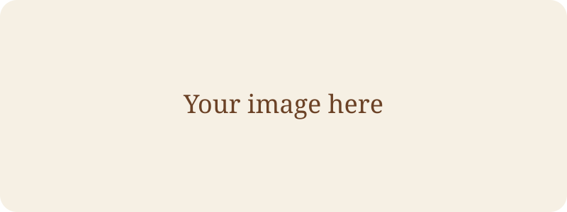

---
# Template post — kept as a draft so it never appears on the live site.
# Easiest way to start a post:  pnpm new:blog "My post title"
title: Post title (max 120 characters)
description: One or two sentences shown on the blog card and in search results (max 260 characters).
pubDate: 2026-01-01
# updatedDate: 2026-02-01
tags: [Tag One, Tag Two]
category: Engineering # Engineering | Philosophy | Claude | Career
# cover: ./images/cover.png   # put images in this post's images/ folder
coverAlt: Describe the cover image for screen readers
# canonical: https://medium.com/...   # if it was first published elsewhere
featured: false
draft: true
---

Write in Markdown. MDX lets you use components too:

<Callout type="tip" title="Callouts">
Use `info`, `tip`, `warning`, or `success`.
</Callout>

## Headings become the table of contents

Math works too: $E = mc^2$.
