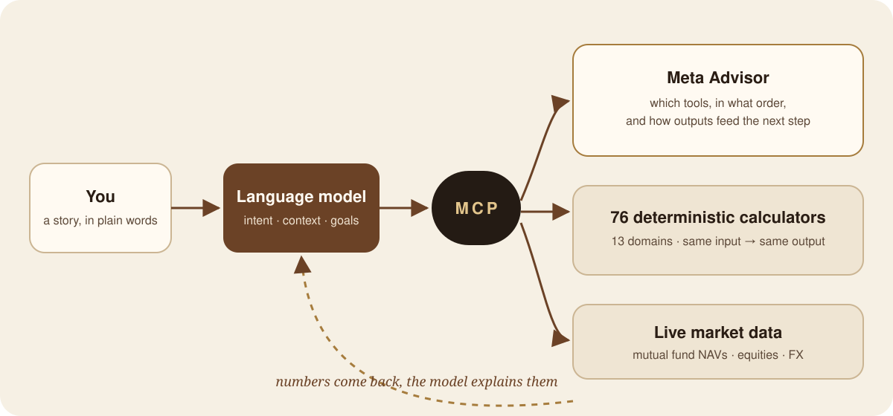
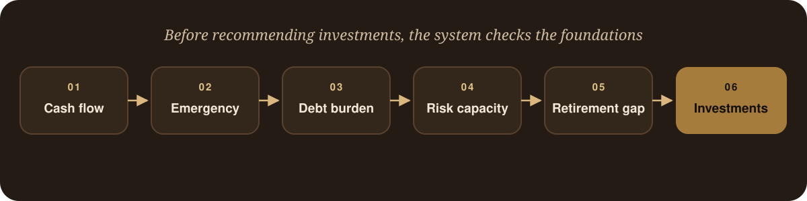

Artificial intelligence is changing how people interact with information. Today, anyone can open a chat window and
ask questions that once required hours of research, professional consultation, or specialised software.

Yet there is one area where I believe we are moving too quickly: **personal finance**.

Ask an AI assistant how much money you need to retire, whether you can afford a home loan, how large your emergency
fund should be, or whether your investment portfolio is properly diversified. In many cases, it will confidently
produce an answer. The language will be polished. The reasoning will sound convincing. The explanation may even
appear sophisticated.

The difficulty is that confidence does not imply accuracy.

Large language models are extraordinary at understanding context, explaining concepts, and translating complexity
into human language. They are not deterministic calculators. They do not inherently understand financial
mathematics. They generate the next most probable token in a sequence of text.

That is an important distinction. Retirement projections are not creative writing. An EMI schedule isn't
narrative. Portfolio risk calculations are not communicative jobs. These are mathematical issues that need strict
repeatability, auditability, and accuracy.

The realisation led me to a simple question:

> What if AI handled the conversation, but mathematics handled the calculations?

That question eventually became [Personal Finance MCP](https://github.com/sarveshtalele/personal-finance-mcp).

## The problem with modern financial AI

These days, the majority of AI-powered financial assistants run on a single engine. A user poses a query. The
request is understood by the language model. Calculations are done by the language model. Suggestions are produced
by the language model. Both arithmetic and logic are handled by the same mechanism. This seemed effective at first.
In reality, however, it poses a considerable risk.

Consider a simple question:

> I'm 30 years old, earn ₹1 lakh per month, spend ₹55,000, have a ₹20,000 EMI, and want to retire at 60. Am I on track?

To answer correctly, a system must perform multiple independent analyses:

- Cash flow assessment
- Debt evaluation
- Emergency fund calculation
- Retirement corpus projection
- Inflation-adjusted future expenses
- SIP requirements
- Risk profiling

These aren't language issues. These are mathematical workflows. A linguistic model may approximate them, but that
is insufficient when someone's financial future is on the line. The answer didn't involve removing AI from the
process. The solution was to redefine its function.

## Separating stories from spreadsheets

Morgan Housel's _The Psychology of Money_ is one of the most significant financial books I've ever read. A constant
theme throughout the book is that money is ultimately a human problem rather than a quantitative one. People do not
base their financial decisions exclusively on spreadsheets. They make decisions based on fear, ambition,
experience, family history, risk tolerance, and personal goals.

The figures are important. However, the story behind the figures is also important. This discovery helped
determine the system's architecture:

- **The AI should understand the story.** The language model determines intent, context, and objectives.
- **Calculators should do the math.** A deterministic financial engine produces every numerical output.

This distinction became the project's core design principle.

## Introducing Personal Finance MCP

Personal Finance MCP is an open-source financial intelligence platform built around a simple idea:

<Callout type="tip" title="The core principle">
Every financial calculation should be deterministic.
</Callout>

The system exposes **76 financial calculators** through the Model Context Protocol (MCP), allowing AI assistants
to access them as tools. Instead of asking users to select calculators manually, the platform lets them
communicate naturally. A user might say _"I want to retire at 60."_ The AI interprets the request. The MCP layer
sends it to the proper tools. Calculators perform the computations. The AI then describes the findings in clear
words. The user engages in a conversation; a deterministic financial engine lies beneath it.

## Designing a financial operating system

From the beginning, I wanted the project to feel less like a collection of calculators and more like a financial
operating system. The platform currently includes 76 tools across 13 major domains, including:

| Domain                     | Examples                                                                              |
| -------------------------- | ------------------------------------------------------------------------------------- |
| Time value of money        | Future value, present value, annuities, inflation-adjusted returns, Rule of 72, EAR  |
| Loans and debt             | EMI, amortization schedules, loan comparison, debt consolidation, prepayment impact  |
| Investment planning        | SIP, lumpsum projections, step-up SIP, SWP planning, goal-based investing            |
| Portfolio analytics        | Sharpe, Sortino, CAPM, beta, alpha, asset allocation analysis                        |
| Retirement planning        | Corpus estimation, retirement gap, SIP requirements, withdrawal planning             |
| Indian savings instruments | PPF, EPF, NSC, SSY, SCSS, KVP                                                         |
| Market data                | Mutual fund NAVs, foreign exchange rates, equity prices                              |

Additional areas include bonds, derivatives, risk profiling, and financial planning. Each tool is deterministic:
the same inputs consistently produce the same outputs.

## The Meta Advisor

Calculators are relatively simple. The bigger challenge was deciding which calculators to use and in what order.
People rarely ask financial questions systematically. They share stories. Someone may state their salary,
expenses, goals, family circumstances, debt commitments, and retirement plans all in the same paragraph. The system
must translate the narrative into a disciplined procedure.

To solve this, I created what I call a **Meta Advisor**, an orchestration layer that assesses the user's
circumstances and determines which tools are required, which calculations should happen first, how outputs feed
into subsequent calculations, and which recommendations should be prioritised.

Retirement planning, for example, is never performed in isolation. The output is a coherent financial plan rather
than a collection of disconnected calculations.

## Why determinism matters

One principle guided every design decision: **financial systems should be reproducible.** If two users provide
identical inputs, they should receive identical results. If someone asks the same question tomorrow, the answer
should not change because the model generated a slightly different sequence of tokens.

- **Auditability.** Every number can be traced back to a formula.
- **Transparency.** Users can understand how results were generated.
- **Trust.** Recommendations become explainable.
- **Testing.** Systems can be validated automatically.
- **Reliability.** Outputs remain consistent over time.

These properties are difficult to achieve with pure language-model systems. They become natural when mathematics
is treated as a first-class component.

## Bringing live markets into the system

Financial planning cannot exist in isolation from market reality. To make recommendations more relevant, the
platform retrieves mutual fund NAVs, equity market data, and foreign exchange rates. Unlike many financial
products, these integrations don't require API keys, so the platform is accessible, easy to deploy, and completely
open source.

## Building for developers

I wanted this system to be modular rather than locked behind a proprietary product. The MCP connector works with
Claude Desktop, Claude Code, Cursor, VS Code, or any MCP-compatible client, and developers can add financial
intelligence to their workflows with a single connector URL.

The same backend powers the MCP server, the web application, the public API, and the test suite. One codebase,
multiple interfaces, consistent behaviour.

## Engineering for trust

Trust cannot be added later. It must be designed into the architecture. The platform includes input validation,
security headers, request limits, parameter constraints, automated testing, and deterministic outputs. Today the
project has **more than 129 automated tests**; each calculator is checked against known results and every key
workflow is tested.

> Financial advice should be as reliable as the formulas that created it.

## What I learned

Building this project changed how I think about AI and finance. AI is most powerful when combined with systems that
provide guarantees. Transparency often matters more than complexity. Users trust systems that show their work.

Most importantly, the future of AI is probably not one massive model doing everything. The future is
**orchestration**: models reasoning over specialised tools, language models managing context, deterministic
systems guaranteeing precision. Each component does what it does best.

## The bigger vision

Personal Finance MCP began as an experiment: could an AI assistant offer financial guidance without using
probabilistic math? The answer turned out to be yes. But the bigger lesson goes beyond finance. Healthcare, law,
engineering, science, and accounting share the same challenge. In each, language models excel at communicating and
dedicated systems ensure accuracy. The most reliable AI systems of the future will combine both.

The AI understands your story. Mathematics shows the truth. Everything else is coordinated.

## Project links

- **GitHub:** [sarveshtalele/personal-finance-mcp](https://github.com/sarveshtalele/personal-finance-mcp)
- **Live demo:** [sarveshtalele-personal-finance-mcp.hf.space](https://sarveshtalele-personal-finance-mcp.hf.space)
- **MCP connector:** `https://sarveshtalele-personal-finance-mcp.hf.space/mcp`
- **PyPI:** `pip install personal-finance-mcp`

---

**Join the discussion.** Should financial AI be allowed to generate calculations directly, or should critical
calculations always be delegated to deterministic tools? I'd love to hear how engineers, architects, fintech
builders, and financial professionals think about this trade-off. Reply on
[LinkedIn](https://www.linkedin.com/in/sarveshtalele) or [Medium](https://medium.com/datadriveninvestor/i-built-a-financial-ai-that-refuses-to-guess-dd4d26e0f578).
