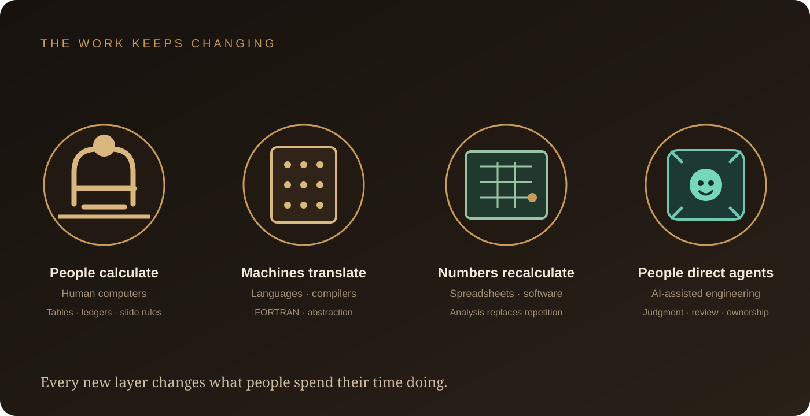
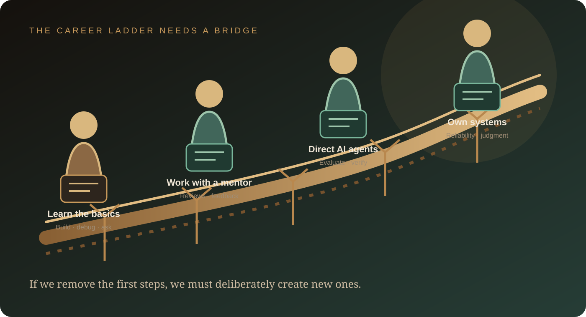

*If machines can write code, what is left for the people who build software? The history of technology offers a more complicated answer than either panic or reassurance.*

There is a particular kind of worry that comes with learning to code today.

You spend months learning Python, JavaScript, databases, algorithms, and the habits of a good engineer. You finally feel ready to build something useful. Then you open an AI coding tool and watch it generate, in a few minutes, what might have taken you an entire evening.

For someone trying to get their first job, that can feel frightening. For someone with ten years of experience, it can feel unsettling. And for people who have built a career around software, it raises a question that is difficult to ignore:

**What happens when the work you were hired to do becomes something a machine can do too?**

That is a fair question. It deserves more than a motivational quote about embracing change. It also deserves more than a dramatic prediction that every developer will soon be unemployed.

The evidence does not support either extreme.

AI is changing software development at a remarkable pace. Some coding tasks are becoming cheaper, faster, or easier to delegate. At the same time, software engineering involves far more than producing lines of code. The harder question is how the work, the skills, and the path into the profession will change.

To understand what may happen next, it helps to look backwards. The history of computing is full of people who watched machines take over work that once required human expertise. Their stories are not proof that today's transition will be painless. But they can help us ask better questions.

## First, it makes sense to be worried

A lot of advice about AI begins with a version of: “Don't worry. Just learn the new tools.”

That advice is incomplete.

Learning new tools can help, but it does not erase the uncertainty people are facing. A student cannot personally redesign the graduate hiring market. A junior developer cannot force a company to keep an apprenticeship programme. A working engineer cannot know exactly which responsibilities will remain valuable five years from now.

And when a technology becomes more capable every few months, planning a career can feel like trying to choose a route while the map is being redrawn.

So let's separate three questions that are often mixed together:

- **Will AI automate more coding tasks?** Yes. That is already happening.
- **Will software engineering jobs change?** Almost certainly. The mix of work and the expectations attached to roles are already shifting.
- **Will software engineers disappear as a profession?** Current evidence does not establish that. It is a much stronger claim than saying that AI can write code.

These distinctions matter. A task can disappear without an entire occupation disappearing. An occupation can grow while becoming harder to enter. A profession can survive while the route into it becomes narrower.

That last possibility deserves much more attention.

## Before computers were machines, they were people

The word *computer* did not originally describe a machine.

It described a person.

For much of the nineteenth and twentieth centuries, organisations employed human computers to perform mathematical calculations. They prepared tables, checked figures, processed observations, and completed calculations used in engineering, astronomy, navigation, finance, and science.

Many of these workers were women. The [Smithsonian American Women's History Museum](https://womenshistory.si.edu/blog/computers-were-machines-they-were-women-here-are-six-places-where-human-computers-built-modern) documents how women such as Sallie Pero Mead, Dorothy Vaughan, and the women who operated the ENIAC contributed to the development of modern computing.

Their work was not trivial. It required mathematical ability, accuracy, patience, and an understanding of the problem being calculated. Yet much of it was repetitive enough to be divided into procedures and eventually transferred to machines.

The first electronic computers entered use after the Second World War. But the transition was not instantaneous. Hand computation and teams of human computers remained common into the 1980s, as electronic capacity gradually caught up with demand. The Smithsonian also notes that women's participation in computing occupations peaked in the late 1980s and then declined over the following two decades.

That history needs to be read carefully. It does not show that every human computer lost a job on the day a machine arrived. Some people moved into programming, operating, research, and other technical work. Some did not. The decline in women's participation also had broader social and institutional causes; it should not be attributed to automation alone.

The lesson is not that technology always creates a better job for everyone it displaces.

The lesson is more uncomfortable: **when a machine takes over a task, the people who performed it do not automatically receive the new opportunities created around that machine.**

The transition depends on access to training, hiring decisions, institutions, and who is allowed to move into the next role.

That is a much more useful lesson for today's developers than the familiar promise that “technology creates more jobs.”

## Programming has been changing itself for decades

There is another reason the current moment feels familiar to computing history: programming has spent much of its life trying to remove the need for people to handle every low-level detail.

In the early 1950s, most programming was done in machine language or assembly language. A programmer had to work close to the instructions understood by the hardware. [John Backus described that early environment in his 1978 history of FORTRAN](https://research.ibm.com/publications/the-history-of-fortran-i-ii-and-iii): much of a programmer's effort went into overcoming the limitations of the computers themselves.

Then came a series of abstractions.

Grace Hopper's early compiler work helped people express instructions in more human-readable forms. In 1957, an IBM team led by Backus developed FORTRAN, a language designed for scientific and mathematical work. The [Computer History Museum](https://www.computerhistory.org/timeline/software-languages/) records that some programmers initially doubted whether a language like FORTRAN could produce code as efficient as hand-written machine instructions. The compiler eventually demonstrated that it could.

Think about what changed.

Programmers no longer needed to express every operation in the form closest to the machine. A language and compiler could translate a more meaningful description into lower-level instructions.

Later came structured programming, databases, libraries, frameworks, visual development environments, cloud services, and infrastructure automation. Each layer made some earlier tasks less central and allowed developers to work at a higher level.

AI coding agents extend that direction. Instead of only translating a programming language into machine instructions, they can help translate a natural-language request into code, tests, edits across files, and sometimes a running application.

That is a meaningful change. It is also part of a longer history.

The important question is not whether abstractions make programming easier. They do. The question is what new responsibilities appear when more implementation work can be delegated.

## The spreadsheet changed office work. It did not change every job overnight.

A useful example comes from outside software engineering.

On October 17, 1979, [VisiCalc was released for the Apple II](https://www.computinghistory.org.uk/det/6990/VisiCalc-Spreadsheet-is-born/). It was the first spreadsheet programme for personal computers, and it made a computer dramatically more useful to people working with numbers.

Before electronic spreadsheets, changing one assumption in a financial model could mean recalculating many figures by hand. A spreadsheet made it possible to change a value and see connected calculations update.

That was not merely a faster calculator. It changed how people could work with information.

The [U.S. Bureau of Labor Statistics](https://www.bls.gov/bls/congressional-reports/assessing-the-impact-of-new-technologies-on-the-labor-market.htm) later described a long decline in clerical occupations as a share of total employment, beginning around 1980 and continuing with the spread of information technology. That is consistent with the automation of routine office tasks, but it would be inaccurate to say that VisiCalc alone caused the decline. Many technologies, business changes, and economic forces contributed.

The broader shift was from manually maintaining records and repeating calculations towards using systems to organise, analyse, and interpret information.

Some tasks became less valuable. Other responsibilities became more important. The people who could understand the business question behind the numbers had a different kind of advantage from those whose work consisted mainly of updating the numbers.

Software engineering may go through a similar change.

If generating a first draft of code becomes inexpensive, the value of an engineer may shift towards deciding what should be built, understanding the environment it must work in, testing whether it is correct, and taking responsibility for what happens after release.

That is not an automatic promotion for every developer. It is a change in the skills employers may reward.

## Photography changed art. It did not make art disappear.

In 1839, the public learned about the daguerreotype, an early photographic process developed by Louis Daguerre. The [Metropolitan Museum of Art](https://www.metmuseum.org/essays/daguerre-1787-1851-and-the-invention-of-photography) notes that Daguerre was already a Romantic painter and printmaker before his photographic work became famous.

Photography changed visual culture. Over time, photographic processes made certain kinds of visual representation more direct, precise, and widely accessible. It also created new artistic possibilities.

Painting did not vanish. It changed in a world where a camera could capture detail in a different way. Artists explored styles, subjects, and forms of expression that did not depend on competing with a camera at its own strength.

This is an analogy, not a forecast. Software is not painting, and a software engineer is not a nineteenth-century portraitist. But it illustrates a broader point:

**A new tool can make one form of production less scarce while making judgment, taste, interpretation, and new forms of work more important.**

The arrival of photography did not make every painter successful. Nor did it preserve every old business model. It changed the landscape in which creative work happened.

AI may do something similar to software. It could make code generation far more accessible while increasing the importance of the decisions around that code.

## The pattern: tasks disappear, and work gets reorganised

Economists have a useful way of describing what happens when technology enters a workplace. In a widely cited 2019 paper, [Daron Acemoglu and Pascual Restrepo](https://www.aeaweb.org/articles?id=10.1257/jep.33.2.3) describe the displacement of existing tasks and the creation of new tasks.

Automation can create a *displacement effect*: machines take over tasks that people previously performed. But technology can also create new tasks in which people have an advantage. Daron Acemoglu and Pascual Restrepo call this a *reinstatement effect*.

These two forces can exist at the same time.

A company might need fewer people for repetitive implementation, but more people for new products, system integration, risk management, customer workflows, and the operation of increasingly complex systems. Or productivity gains may be captured by a small number of firms without creating enough new work to offset the roles that disappear.

There is no law that says the new tasks will arrive quickly enough, in the same locations, at the same salaries, or for the same people.

This is why “technology creates jobs” is not a complete answer to someone worried about their livelihood.

The better questions are:

- Which tasks are being automated?
- Which new tasks are appearing?
- Who gets the training needed to perform them?
- Are companies creating pathways into those roles?
- Who receives the productivity gains?

Those questions take us from abstract optimism to the real experience of workers.

## What the evidence says right now

We do not have a complete picture of AI's long-term effect on software employment. But several recent indicators help show where change is already visible.

### Developers are using agents at a remarkable scale

[GitHub's 2026 Octoverse report](https://github.blog/news-insights/octoverse/octoverse-commits-pushes-reach-new-highs-in-2026-as-developers-build-with-agents/) says that more than 40% of pull requests on GitHub began with an agent's first draft in September 2026, compared with 17% in March. GitHub reported around 110 million agent-started pull requests in September alone.

That is a striking adoption signal. But the wording matters: *agent-started* does not mean every line was written by an agent, that the code was correct, or that a human did not review and change it. GitHub's own report describes developers directing agents and then shaping the result through review.

The shift is still important. More developers are starting work by specifying an outcome and supervising an agent rather than writing every first draft manually.

### Software job postings are not telling a simple collapse story

[Indeed Hiring Lab reported in July 2026](https://hiringlab.indeed.com/2026/07/08/ai-and-job-postings-from-destruction-to-creation/) that U.S. software development job postings had risen almost 15% since late February 2025, while overall job postings had fallen 7%.

But the recovery was uneven. Indeed estimated that 71% of the increase in software development postings between May 2025 and May 2026 came from senior roles, while 37% came from job titles mentioning AI. These categories overlap; they should not be added together. The same report noted that software development postings were still about 27.5% below their pre-pandemic level.

This is job-posting data, not a count of people actually hired. It cannot prove that AI caused the rebound. But it does suggest that demand is changing in composition, not simply moving in one direction.

### The early-career warning is more serious

A [Stanford Digital Economy Lab working paper, revised in August 2026](https://digitaleconomy.stanford.edu/publication/canaries-in-the-coal-mine-six-facts-about-the-recent-employment-effects-of-artificial-intelligence/), analysed ADP payroll data covering millions of U.S. workers through June 2026.

The researchers found no evidence of widespread, economy-wide job displacement. However, they estimated that employment among workers aged 22–25 in occupations highly exposed to AI was 19% below where it would have been if it had kept pace with employment among less-exposed peers. The divergence appeared primarily through reduced hiring of young workers rather than increased separations.

This is not a software-developer-only statistic, and it is not proof that AI alone caused every part of the difference. It is a warning signal across AI-exposed occupations: the pressure may be appearing first in opportunities for younger workers.

[Anthropic's own October 2026 analysis](https://www.anthropic.com/research/employment-at-anthropic) offers a company-specific example. Within its core technical departments, the share of junior-level employees declined from 21% to 14%; the share of junior employees among technical hires fell from 27% to 9%. Anthropic is one company at the frontier of AI adoption, not a representative sample of the entire software industry. Its experience cannot be generalised to every employer. Still, it shows how an organisation using AI heavily may rethink the number and type of junior roles it hires for.

### Productivity is real, but it is difficult to measure

It is tempting to assume that because an AI tool writes code quickly, the whole development process must be faster.

The evidence is more nuanced.

In an early-2025 controlled study, [METR found that experienced open-source developers took about 19% longer](https://metr.org/blog/2026-02-24-uplift-update/) to complete a selected set of tasks when using the AI tools available during that experiment. In its February 2026 update, METR explained that a later experiment had serious selection and measurement problems, including developers choosing not to participate if they had to work without AI and difficulty measuring work involving multiple agents. The later data were therefore weak evidence about the exact size of any productivity gain.

That does not mean AI tools are generally unproductive. It means results depend on the task, the developer, the model, the workflow, and how productivity is measured. A quick first draft is not the same thing as a reliable feature in production.

Taken together, these indicators point to a more complicated picture than “developers are finished” or “nothing is changing.”

AI use is spreading. Software job postings have not collapsed in a straight line. At the same time, there are concerning signs around junior hiring and the experience gap.

**The profession may be changing from the bottom of the ladder before it disappears from the top.**

## The part that worries me most: the first job

For years, many software careers began with relatively small responsibilities.

A new developer fixed a bug, wrote a test, updated a page, adjusted a query, reviewed a pull request, or investigated a small production issue. These tasks were not glamorous. But they taught something that a tutorial could not fully teach: how real software behaves when it meets real users, old systems, incomplete requirements, and unexpected failures.

A junior developer learned by doing small pieces of consequential work.

Now consider what happens when an AI agent can complete many of those tasks quickly.

A company may decide that it needs fewer people for routine implementation. It may expect each experienced engineer to supervise more work. It may hire fewer juniors and seek candidates who can already operate at a higher level.

That can make economic sense to an individual company. But it creates a problem for the profession.

**If fewer beginners are given the chance to learn on the job, where will the next generation of experienced engineers come from?**

This is the apprenticeship problem.

The danger is not only that some entry-level tasks become automated. It is that organisations may remove the very experiences through which people learn to become senior engineers.

A generation of developers could be told to gain experience before being hired, while the traditional places to gain that experience quietly disappear.

That would be a serious mistake.

Companies cannot expect AI to produce experienced engineers out of nowhere. Experience comes from diagnosing failures, making trade-offs, receiving feedback, understanding consequences, and gradually taking on responsibility. Those things need to be taught and practised.

The first job may become more important precisely because it is becoming harder to find.

## So, what should you learn now?

There is no single skill that guarantees a safe career. Anyone promising one is selling certainty that does not exist.

But there are capabilities that become more valuable when code generation gets cheaper.

### 1. Learn to understand the problem before writing code

A vague request can produce a large amount of useless code.

Learn to ask what the user is trying to achieve, what constraints matter, what can go wrong, and what a successful outcome would look like. Good requirements are a technical skill.

### 2. Understand how systems fit together

Learn databases, APIs, authentication, networking, deployment, cloud infrastructure, distributed systems, and system design.

You do not need to know every technology. You do need to understand how one decision affects the rest of a system. An agent can generate a service, but someone must understand how it behaves inside the larger environment.

### 3. Become excellent at verification

Learn to write meaningful tests, review code, reproduce bugs, inspect logs, measure performance, and evaluate security risks.

Do not accept an AI-generated answer simply because it looks convincing. Ask what evidence would prove it works. Learn to test assumptions, not just happy paths.

### 4. Learn to work with agents without surrendering judgment

Use AI tools to explore options, generate drafts, refactor code, write tests, and investigate unfamiliar systems. But understand the output.

A strong engineer should be able to explain what an agent changed, why the design is appropriate, what trade-offs were made, and what must be checked before shipping.

The goal is not to become the person who writes the longest prompt. It is to become the person who can direct work, evaluate results, and take responsibility for the outcome.

### 5. Build depth in a real domain

Software becomes valuable when it solves a problem in healthcare, finance, manufacturing, logistics, education, security, or another field.

Domain knowledge helps you recognise when a technically plausible answer is wrong for the real world. It also helps you identify problems worth solving.

### 6. Communicate clearly and take ownership

Engineering work is collaborative. Explain trade-offs, write useful documentation, discuss risks, and help other people make decisions.

When implementation becomes faster, coordination and judgment can become more visible—not less.

### A practical way to prepare

Rather than collecting dozens of AI tools, build one complete project and use it to demonstrate how you think.

1. Choose a real problem and write down who experiences it and why it matters.
2. Define the requirements, constraints, and acceptance criteria before asking an agent to build anything.
3. Use an AI tool to help implement a small part of the system. Review every important change.
4. Add tests, security checks, logging, and a deployment path. Document what failed and how you fixed it.
5. Publish the project with an architecture diagram, a clear README, trade-offs, limitations, and a short demonstration.

A project that shows your decisions is more convincing than a portfolio full of applications you cannot explain.

For experienced engineers, the same principle applies at a larger scale: learn to lead AI-assisted workflows while retaining ownership of architecture, quality, reliability, and outcomes.

## Companies have a responsibility too

Career advice often places the entire burden on individuals: learn faster, adapt faster, become more productive.

That is only half the story.

Employers benefit when AI reduces the cost of implementation. They also have a responsibility to think about how people develop the experience required to operate complex systems.

A healthier apprenticeship model might give junior engineers responsibility for:

- Reviewing and testing agent-generated code against explicit acceptance criteria.
- Reproducing bugs and investigating why a proposed fix does or does not work.
- Owning small features from requirements through deployment and monitoring.
- Comparing alternative designs and explaining the trade-offs.
- Learning from code reviews, incidents, and structured technical mentorship.

These are not make-work exercises. They are how people learn to exercise judgment.

If companies automate every beginner task but continue to demand experienced candidates, they risk weakening their own future talent pipeline.

## Three futures can exist at the same time

It is easy to imagine one future for software engineering. In reality, several outcomes may happen together.

**In one future, more people build software.** AI lowers the barrier to creating prototypes and internal tools. People outside traditional engineering roles can solve problems that once required a specialist.

**In another future, smaller teams deliver more.** Experienced engineers use agents to handle more implementation work. Some organisations hire fewer people for the same amount of output, while others build more ambitious products.

**In a third future, expertise becomes even more valuable.** As generated code becomes abundant, dependable systems remain difficult. Security, architecture, data quality, reliability, compliance, and accountability continue to demand serious engineering judgment.

These futures are not mutually exclusive. A company can create more software, employ a smaller team, and demand deeper expertise from the people it retains.

The real question is how the benefits and the risks are distributed.

## So, will AI take your coding job?

I would not tell a student that everything will be fine. I would not tell an experienced engineer that their career is over either.

Both statements pretend to know more than the evidence allows.

What history does tell us is that technology changes the value of tasks. People who once performed calculations by hand moved into a world of machine computing. Programmers moved from machine instructions to languages, libraries, and frameworks. Office workers moved from paper records to spreadsheets and information systems. Artists learned to work in a world transformed by photography.

Those transitions created opportunities, but they also caused disruption. Not everyone benefited equally. Not every old job returned in a new form.

AI is now putting another layer of abstraction between people and the production of software.

That makes coding more accessible. It also makes some traditional ways of learning and earning a living less secure.

So do not measure your future only by how quickly you can type code. Learn to understand problems, design systems, test assumptions, work with AI, and take responsibility for what you build.

And if you are just starting out, remember this: being a beginner is not a personal failure. Every experienced engineer was once one. The industry needs to preserve meaningful ways for people to learn, or it will eventually discover that it has automated away part of its own future.

**AI may change how software gets written. The people who understand what should be built, why it matters, and how to make it dependable will still have important work to do.**

The future of coding is not simply about humans versus machines.

It is about what we choose to automate, what we choose to value, and whether we build a path forward that leaves room for people to grow.

---

## Sources and further reading

These sources informed the historical examples and the contemporary labour-market discussion. The employment studies describe different populations and use different methods; none should be read as a precise forecast of software engineering jobs.

1. [Smithsonian American Women's History Museum — Before Computers Were Machines, They Were Women](https://womenshistory.si.edu/blog/computers-were-machines-they-were-women-here-are-six-places-where-human-computers-built-modern)
2. [Computer History Museum — Software & Languages timeline](https://www.computerhistory.org/timeline/software-languages/)
3. [John Backus — The History of FORTRAN I, II, and III (IBM Research)](https://research.ibm.com/publications/the-history-of-fortran-i-ii-and-iii)
4. [U.S. Bureau of Labor Statistics — Assessing the Impact of New Technologies on the Labor Market](https://www.bls.gov/bls/congressional-reports/assessing-the-impact-of-new-technologies-on-the-labor-market.htm)
5. [Computer History Museum — VisiCalc, October 17, 1979](https://www.computinghistory.org.uk/det/6990/VisiCalc-Spreadsheet-is-born/)
6. [The Metropolitan Museum of Art — Daguerre and the Invention of Photography](https://www.metmuseum.org/essays/daguerre-1787-1851-and-the-invention-of-photography)
7. [Acemoglu and Restrepo — Automation and New Tasks: How Technology Displaces and Reinstates Labor (2019)](https://www.aeaweb.org/articles?id=10.1257/jep.33.2.3)
8. [GitHub — Octoverse 2026: Developers Build with Agents](https://github.blog/news-insights/octoverse/octoverse-commits-pushes-reach-new-highs-in-2026-as-developers-build-with-agents/)
9. [Indeed Hiring Lab — AI and Job Postings: From Destruction to Creation? (July 2026)](https://hiringlab.indeed.com/2026/07/08/ai-and-job-postings-from-destruction-to-creation/)
10. [Stanford Digital Economy Lab — Canaries in the Coal Mine? (revised August 12, 2026)](https://digitaleconomy.stanford.edu/publication/canaries-in-the-coal-mine-six-facts-about-the-recent-employment-effects-of-artificial-intelligence/)
11. [Anthropic — How Employment Is Changing at Anthropic (October 2026)](https://www.anthropic.com/research/employment-at-anthropic)
12. [METR — We Are Changing Our Developer Productivity Experiment Design (February 2026)](https://metr.org/blog/2026-02-24-uplift-update/)
